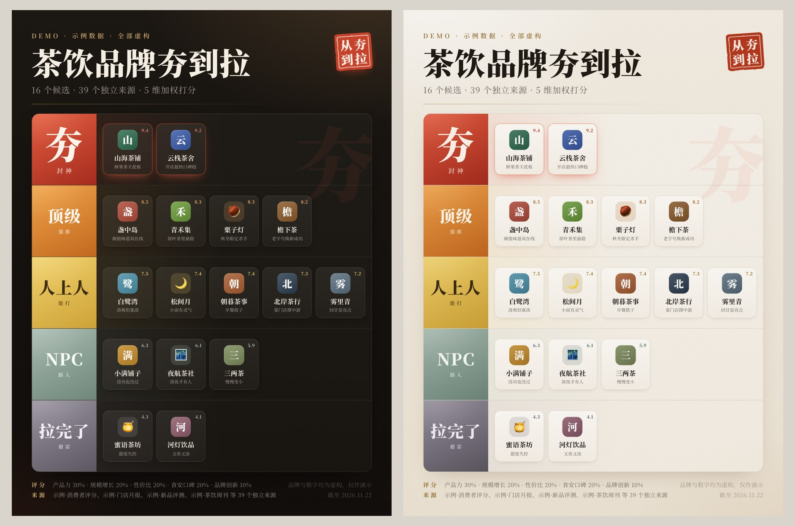
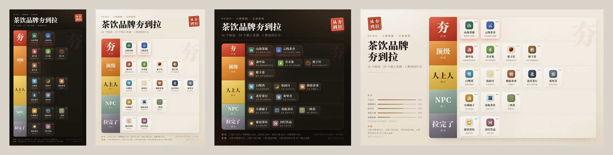

# z-hang-tierlist 夯到拉排行榜

给任意主题做一张「夯 / 顶级 / 人上人 / NPC / 拉完了」五档梯度榜。Agent 先广泛查资料，按 3~5 个加权维度给每个候选打分，脚本复算加权分并自动分档，再出一张暗金或宣纸风格的榜单 PNG。榜上每个分数都能在同时生成的 `evidence.md` 里找到带链接的出处。



<sub>图中的品牌、数字、来源全部虚构，只用来演示版式；数据在 [`examples/demo/`](examples/demo/)。</sub>

```bash
npx skills add tjxj/z-skills --skill z-hang-tierlist
pip install -r requirements.txt && python3 -m playwright install chromium
```

然后对 Agent 说「给国产大模型排个夯到拉」「新茶饮品牌夯拉榜，9:16」「2026 旗舰手机 tier list，宣纸风」。完整流程见 [SKILL.md](SKILL.md)。

## 做出来什么

| 文件 | 内容 |
| --- | --- |
| `<主题>-夯到拉-3x4.png` | 榜单图：每个候选有图标、加权分、一句锐评；页脚写评分维度、主要来源和截至日期 |
| `evidence.md` | 评分依据表：维度与打分锚点、排名总表、每个候选的证据（带链接、日期、类型）、资料来源清单 |
| `data.json` | 全部数据；改完分数或锐评，重新 `build` 就能出新图 |

## 怎么做到有理有据

- **先查最新**：模型的知识有截止日期。动手前先确认今天的日期、每个候选的当前版本和最近 1~3 个月的变化，页脚的「截至日期」会写上图。
- **三轮搜索**：全景（榜单、市场份额、年度盘点）定候选池，逐个候选查硬数字，最后专门搜负面（翻车、投诉、召回、争议）。信源分一手、权威榜单、专业评测、权威媒体、口碑、线索六级，线索只用来顺藤摸瓜找出处。
- **横向打分**：一次只看一个维度，把所有候选放在一起排一遍再给分。每个维度写明 10 / 7 / 4 / 1 分的锚点，尽量绑定可查的数字。
- **分档交给脚本**：加权分 ≥ 9.0 夯，≥ 8.0 顶级，≥ 7.0 人上人，≥ 5.5 NPC，其余拉完了。某档没人就显示「虚位以待」；确要改档，必须写 `override_reason`，依据表里会公开。
- **校验把关**：`check` 会拦住证据不够硬的榜单。

| 规则 | 要求 |
| --- | --- |
| 每个候选 | 至少 2 条证据，其中有硬数字、有链接 |
| 进「夯」 | 至少 3 条证据 |
| 进「拉完了」 | 至少 1 条标 `neg` 的负面实锤 |
| 全榜来源 | 独立链接 ≥ max(10, 候选数 × 0.8)，来自 ≥ 6 个网站、≥ 3 类信源 |
| 分数分布 | 夯太多、某一档扎堆、离分档线不到 0.15（压线）都会提醒 |

## 尺寸和风格

| 参数 | 像素 | 场景 |
| --- | --- | --- |
| `3:4`（默认） | 1200×1600 | 公众号配图、小红书 |
| `4:5` | 1080×1350 | Instagram、朋友圈 |
| `1:1` | 1080×1080 | 方图 |
| `9:16` | 1080×1920 | 抖音、视频号、手机壁纸 |
| `2:3` | 1200×1800 | 长竖图 |
| `4:3` | 1600×1200 | 横版文章配图 |
| `16:9` | 1920×1080 | B 站封面、PPT、视频画面 |

`--size 3:4,16:9` 一次出几张，`--size all` 出全部，`--size 1242x1660` 指定任意像素，`--hd` 出 2 倍图。



<sub>同一份数据的四种尺寸，从左到右：9:16、4:5、1:1、16:9。</sub>

排版全自动：候选少时用方块卡片，多了换横条，再多换紧凑条，字号在能放下的前提下取最大；横版把标题、评分维度和来源放进左侧栏。出图后终端会报告排版模式，名字或锐评被截断时给出修改提示。

风格有两套：`ink`（暗金，默认）和 `paper`（宣纸），用 `--theme paper` 切换。

## 跑一遍示例

```bash
cd z-hang-tierlist
python3 scripts/tierlist.py check examples/demo/data.json
python3 scripts/tierlist.py build examples/demo/data.json --size 3:4,16:9 --out out
python3 scripts/tierlist.py build examples/demo/data.json --theme paper --out out-paper
```

[`examples/demo/`](examples/demo/) 里放着这份虚构数据的 [`data.json`](examples/demo/data.json)、暗金和宣纸两张 PNG，以及生成好的 [`evidence.md`](examples/demo/evidence.md)。自己做一张榜时，先建任务目录：

```bash
python3 scripts/tierlist.py new "主题"    # 在 ./夯到拉/<日期>-<主题>/ 里建 data.json 骨架
```

一个候选在 `data.json` 里长这样，全部字段见 [`references/spec.md`](references/spec.md)：

```json
{
  "name": "山海茶铺",
  "icon": {"mono": "山", "color": "#2F6B4F"},
  "scores": {"taste": 9.5, "scale": 9.0, "price": 9.5, "safety": 10, "brand": 8.5},
  "verdict": "鲜果茶天花板",
  "evidence": [
    {"text": "消费者评分 4.8 / 5，21 万条评价，同榜第一", "source": "某评分站", "url": "https://…", "date": "2026-10", "type": "口碑"}
  ]
}
```

## 依赖

- Python 3，`pip install -r requirements.txt`（Pillow、Playwright）
- Playwright 的 Chromium：`python3 -m playwright install chromium`
- 联网搜索和读网页由 Agent 自带的工具完成，脚本本身离线运行
- 字体：默认思源宋体 VF（`~/Library/Fonts/SourceHanSerifSC-VF.ttf`），找不到时依次尝试 Noto Serif CJK，最后退回系统宋体；环境变量 `TIERLIST_FONT` 可指定字体文件
- 环境变量 `TIERLIST_OUT` 改变 `new` 的默认根目录（默认 `./夯到拉`）
- 长期要避开的词写进 `forbid.local.txt`（不入库），格式见 `forbid.txt`

## 局限

- 榜单的质量取决于资料。脚本检查证据的数量和来源面，事实要靠人核实：发布前按 `evidence.md` 抽查关键数字
- 模型、手机、榜单这类时效性强的主题只用最近 3 个月的数据，页脚的截至日期按生成当天写
- 图标默认用字标（文字加品牌色）或 emoji；用别人的 logo 之前先想清楚商标授权。emoji 选 Unicode 13 以内的常见款，太新的可能显示成方框
- 公司和真人上榜时，负面只写可查证的事实（监管通报、判决、官方致歉、权威媒体报道）；评真人只评作品和业绩
- 候选建议 12~20 个，超过 30 个会溢出，需要换 9:16、16:9 或者减少候选

## 目录结构

```text
z-hang-tierlist/
  SKILL.md               工作流和硬规则
  README.md
  requirements.txt
  forbid.txt             禁用词表说明
  scripts/tierlist.py    new / check / build 三个命令
  assets/template.html   版式模板：主题色、档位颜色、自适应排版
  references/
    research.md          查资料的方法、信源分级、搜索词模板
    rubrics.md           常见主题的维度和打分锚点：大模型、手机、茶饮、游戏、影视、城市、编程语言、汽车等
    spec.md              data.json 字段说明
  examples/demo/         虚构数据的完整示例
  docs/                  README 配图
```
