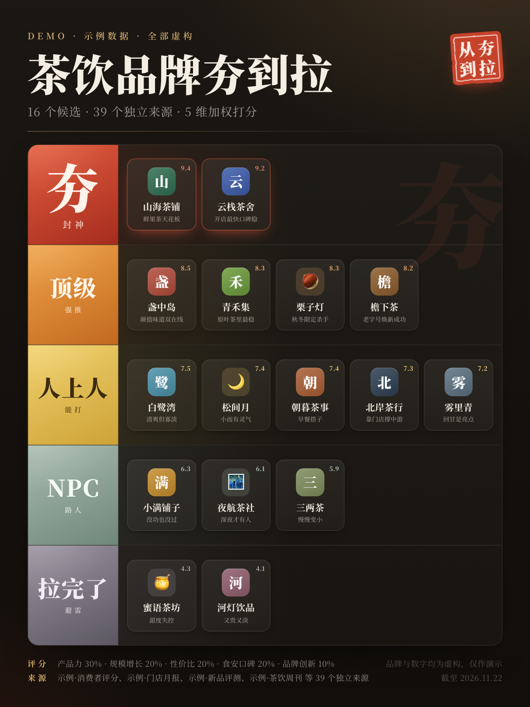

# 茶饮品牌夯到拉｜夯到拉排行榜·评分依据

截至 2026-11-22 · 16 个候选 · 39 个独立来源（7 个网站）· 5 维加权打分

**范围**：演示数据：榜上 16 个品牌、全部数字和来源都是虚构的，只用来展示版式和流程，不对应任何真实品牌。收录规则（示意）：2026 年 11 月仍在营业、门店 100 家以上的连锁茶饮品牌。

## 评分维度

| 维度 | 权重 | 怎么打分 |
|---|---|---|
| 产品力 | 30% | 10=爆品多、复购高、口味评分最高；7=稳定好喝；4=一般；1=难喝 |
| 规模增长 | 20% | 10=门店数行业前 3 且仍在增长；7=规模大或增速快；4=停滞；1=大面积闭店 |
| 性价比 | 20% | 10=同品质最便宜；7=价格合理；4=偏贵；1=又贵又不好 |
| 食安口碑 | 20% | 10=几乎无通报、评分最高；7=偶有投诉；4=投诉较多；1=有监管通报或重大安全事件 |
| 品牌创新 | 10% | 10=联名和新品频频出圈；7=有亮点；4=跟风；1=老化 |

分档线（加权分，满分 10）：夯 ≥ 9.0，顶级 ≥ 8.0，人上人 ≥ 7.0，NPC ≥ 5.5，低于 5.5 为拉完了。

## 排名总表

| 排名 | 档位 | 候选 | 产品力 | 规模增长 | 性价比 | 食安口碑 | 品牌创新 | 加权分 | 锐评 |
|---|---|---|---|---|---|---|---|---|---|
| 1 | 夯 | 山海茶铺 | 9.5 | 9 | 9.5 | 10 | 8.5 | 9.40 | 鲜果茶天花板 |
| 2 | 夯 | 云栈茶舍 | 9.5 | 9.5 | 8.5 | 9 | 9.5 | 9.20 | 开店最快口碑稳 |
| 3 | 顶级 | 盏中岛 | 9 | 8 | 8 | 8.5 | 8.5 | 8.45 | 颜值味道双在线 |
| 4 | 顶级 | 青禾集 | 8.5 | 8 | 8.5 | 8.5 | 7.5 | 8.30 | 原叶茶里最稳 |
| 5 | 顶级 | 栗子灯 | 8.5 | 7 | 9 | 8.5 | 8 | 8.25 | 秋冬限定杀手 |
| 6 | 顶级 | 檐下茶 | 8 | 9 | 8 | 8 | 8 | 8.20 | 老字号焕新成功 |
| 7 | 人上人 | 白鹭湾 | 7.5 | 7 | 7.5 | 8 | 7 | 7.45 | 清爽但寡淡 |
| 8 | 人上人 | 松间月 | 8 | 5.5 | 7.5 | 8 | 8 | 7.40 | 小而有灵气 |
| 9 | 人上人 | 朝暮茶事 | 7.5 | 7.5 | 7.5 | 7 | 7 | 7.35 | 早餐搭子 |
| 10 | 人上人 | 北岸茶行 | 7 | 8 | 7 | 7.5 | 6.5 | 7.25 | 靠门店撑中游 |
| 11 | 人上人 | 雾里青 | 7.5 | 6.5 | 7 | 7.5 | 7.5 | 7.20 | 回甘是亮点 |
| 12 | NPC | 小满铺子 | 6 | 6.5 | 6.5 | 6.5 | 6 | 6.30 | 没功也没过 |
| 13 | NPC | 夜航茶社 | 6 | 5 | 6 | 7 | 7 | 6.10 | 深夜才有人 |
| 14 | NPC | 三两茶 | 5.5 | 6 | 6.5 | 6 | 5 | 5.85 | 慢慢变小 |
| 15 | 拉完了 | 蜜语茶坊 | 3.5 | 7 | 4 | 2.5 | 5 | 4.25 | 甜度失控 |
| 16 | 拉完了 | 河灯饮品 | 4 | 6 | 3.5 | 3 | 4 | 4.10 | 又贵又淡 |

## 逐个说依据

### 夯

**山海茶铺** · 9.40 · 鲜果茶天花板

- 2026 年 9 月门店 3,180 家，近 12 个月净增 410 家（虚构）（[示例·门店月报](https://store-report.example/2026-09/shanhai)，2026-09，市场）
- 消费者评分 4.8 / 5，21 万条评价，同榜第一（虚构）（[示例·消费者评分](https://rating.example/brands/shanhai)，2026-10，口碑）
- 近 12 个月无食安通报，抽检合格率 100%（虚构）（[示例·食安通报](https://safety.example/2026/shanhai)，2026-10，官方）
- 鲜果茶系列月销破 1,000 万杯，入选年度十大饮品（虚构）（[示例·年度榜单](https://annual-rank.example/2026/shanhai)，2026-10，榜单）

**云栈茶舍** · 9.20 · 开店最快口碑稳

- 门店 4,060 家，行业第二，近 12 个月净增 720 家（虚构）（[示例·门店月报](https://store-report.example/2026-09/yunzhan)，2026-09，市场）
- 2026 年三季度营收 38 亿元，同比增长 24%（虚构）（[示例·财报摘要](https://finance.example/2026q3/yunzhan)，2026-10，官方）
- 新品「桂花云顶」上市 30 天卖出 900 万杯（虚构）（[示例·茶饮周刊](https://weekly.example/2026/yunzhan-osmanthus)，2026-10，媒体）

### 顶级

**盏中岛** · 8.45 · 颜值味道双在线

- 联名杯套带动周边销售，联名款占销售额 31%（虚构）（[示例·茶饮周刊](https://weekly.example/2026/zhanzhongdao-collab)，2026-10，媒体）
- 评分 4.6 / 5，「颜值高」在好评关键词里排第 1（虚构）（[示例·消费者评分](https://rating.example/brands/zhanzhongdao)，2026-10，口碑）

**青禾集** · 8.30 · 原叶茶里最稳

- 原叶茶底盲测第一，口味得分 8.9 / 10（虚构）（[示例·新品评测](https://review.example/blind-test/qinghe)，2026-09，评测）
- 门店 1,420 家，覆盖 61 个城市（虚构）（[示例·门店月报](https://store-report.example/2026-09/qinghe)，2026-09，市场）

**栗子灯** · 8.25 · 秋冬限定杀手

- 秋冬限定款 6 周卖出 1,100 万杯，复购率 46%（虚构）（[示例·茶饮周刊](https://weekly.example/2026/lizideng-autumn)，2026-11，媒体）
- 评分 4.6 / 5，主力价位 14-18 元（虚构）（[示例·消费者评分](https://rating.example/brands/lizideng)，2026-10，口碑）

**檐下茶** · 8.20 · 老字号焕新成功

门店数两处口径不同（直营加加盟 / 仅直营），取低值

- 创立 28 年，焕新后门店从 900 家增至 2,300 家（虚构）（[示例·财报摘要](https://finance.example/2026q3/yanxia)，2026-10，官方）
- 评分 4.5 / 5，老客复购占 58%（虚构）（[示例·消费者评分](https://rating.example/brands/yanxia)，2026-10，口碑）

### 人上人

**白鹭湾** · 7.45 · 清爽但寡淡

- 评分 4.3 / 5，好评集中在「清爽」，差评集中在「寡淡」（虚构）（[示例·消费者评分](https://rating.example/brands/bailuwan)，2026-10，口碑）
- 门店 860 家，近 12 个月净增 90 家（虚构）（[示例·门店月报](https://store-report.example/2026-09/bailuwan)，2026-09，市场）

**松间月** · 7.40 · 小而有灵气

评价数只有 1.2 万条，口碑分的样本偏小，给分偏保守

- 仅 140 家店，坪效是行业均值的 1.8 倍（虚构）（[示例·财报摘要](https://finance.example/2026q3/songjianyue)，2026-10，官方）
- 评分 4.7 / 5，评价数 1.2 万条（虚构）（[示例·消费者评分](https://rating.example/brands/songjianyue)，2026-10，口碑）

**朝暮茶事** · 7.35 · 早餐搭子

- 门店 1,900 家，早餐时段订单占 35%（虚构）（[示例·财报摘要](https://finance.example/2026q3/zhaomu)，2026-10，官方）
- 同价位盲测排第 4 / 10（虚构）（[示例·新品评测](https://review.example/blind-test/zhaomu)，2026-09，评测）

**北岸茶行** · 7.25 · 靠门店撑中游

- 门店 2,700 家，三线以下城市占 64%（虚构）（[示例·门店月报](https://store-report.example/2026-09/beian)，2026-09，市场）
- 同价位盲测排第 6 / 10（虚构）（[示例·新品评测](https://review.example/blind-test/beian)，2026-09，评测）

**雾里青** · 7.20 · 回甘是亮点

- 门店 640 家，近 12 个月净增 55 家（虚构）（[示例·门店月报](https://store-report.example/2026-09/wuliqing)，2026-09，市场）
- 评分 4.2 / 5，好评集中在「回甘」（虚构）（[示例·消费者评分](https://rating.example/brands/wuliqing)，2026-10，口碑）

### NPC

**小满铺子** · 6.30 · 没功也没过

- 门店 1,050 家，一年净增 12 家，基本持平（虚构）（[示例·门店月报](https://store-report.example/2026-09/xiaoman)，2026-09，市场）
- 评分 4.0 / 5，评价集中在「还行」（虚构）（[示例·消费者评分](https://rating.example/brands/xiaoman)，2026-10，口碑）

**夜航茶社** · 6.10 · 深夜才有人

- 营业时间 18:00 至次日 02:00，白天门店空置率 71%（虚构）（[示例·茶饮周刊](https://weekly.example/2026/yehang-hours)，2026-09，媒体）
- 评分 4.1 / 5，夜间订单占 83%（虚构）（[示例·消费者评分](https://rating.example/brands/yehang)，2026-10，口碑）

**三两茶** · 5.85 · 慢慢变小

- 门店 520 家，近 12 个月净减 8 家（虚构）（[示例·门店月报](https://store-report.example/2026-09/sanliang)，2026-09，市场）
- 评分 3.9 / 5，评价量 3.4 万条（虚构）（[示例·消费者评分](https://rating.example/brands/sanliang)，2026-10，口碑）

### 拉完了

**蜜语茶坊** · 4.25 · 甜度失控

- 【负面】近 3 个月被投诉 1,280 次，主要是甜度失控和出杯慢（虚构）（[示例·消费者评分](https://rating.example/complaints/miyu)，2026-10，口碑）
- 【负面】抽检 3 次不合格，糖分标注与实测相差 2.3 倍（虚构）（[示例·食安通报](https://safety.example/2026/miyu-sugar)，2026-09，官方）
- 门店 3,300 家，靠低价快速扩张（虚构）（[示例·门店月报](https://store-report.example/2026-09/miyu)，2026-09，市场）

**河灯饮品** · 4.10 · 又贵又淡

- 【负面】2026 年 8 月因原料过期被通报，涉及 36 家门店（虚构）（[示例·食安通报](https://safety.example/2026/hedeng-expired)，2026-08，官方）
- 【负面】评分 3.1 / 5，「味道淡」「奶茶像糖水」是高频差评（虚构）（[示例·消费者评分](https://rating.example/brands/hedeng)，2026-10，口碑）
- 同价位盲测倒数第 2 / 10（虚构）（[示例·新品评测](https://review.example/blind-test/hedeng)，2026-09，评测）

## 资料来源

1. [示例·年度榜单](https://annual-rank.example/2026) · 榜单 · 2026-10 · 年度十大饮品（虚构）
2. [示例·门店月报](https://store-report.example/) · 市场 · 2026-09 · 门店数口径：营业中的直营加加盟（虚构）
