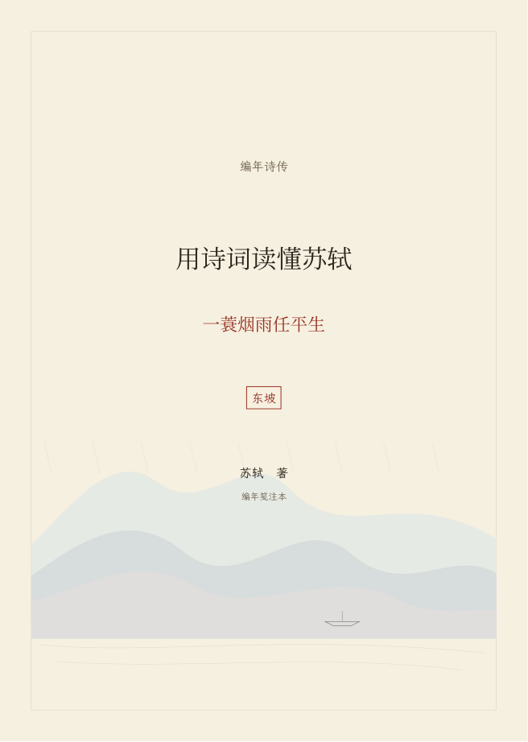
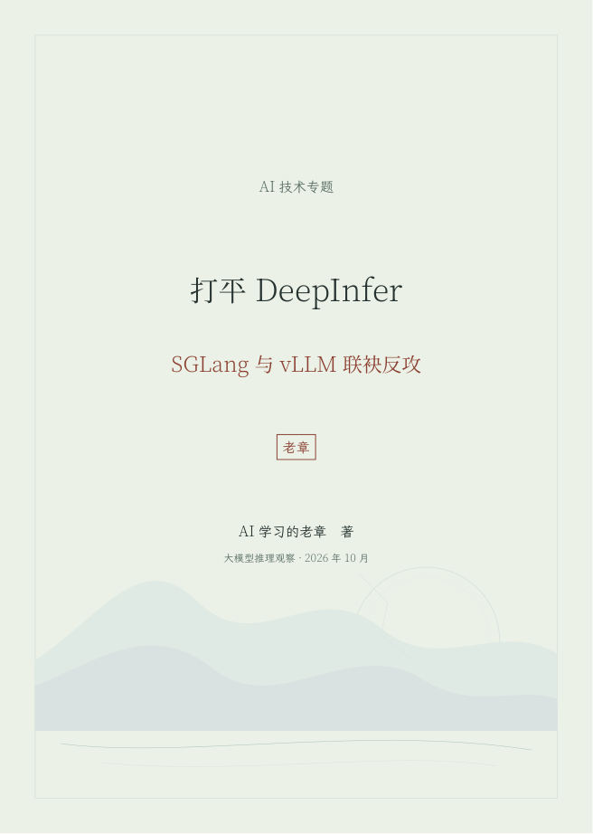

# Poetry Book

把诗词、古籍资料、技术文章和课程讲义，做成**有出处、可重建、经过逐页检查的 LaTeX PDF**。

这不是一张封面模板，而是一条完整流水线：资料结构化 → 编年或文章块解析 → 六套主题排版 → 字体与内容检查 → PDF、来源清单和预览图。


## 能做什么

- **编年诗传与文集**：作品排序、未系年附录、题解、笺注、批语、出处和篇名索引。
- **技术图文专题**：解析 Markdown 标题、粗体、列表、链接、图片、代码块、简单表格和引用。
- **六套真实主题**：每套都能生成完整 PDF，不只是颜色名称。
- **来源可追踪**：原稿、图片地址、SHA-256、作品页映射和构建清单一并保留。
- **结果可验证**：检查缺字、字体嵌入、溢出、越界、异常空白页、横排、链接、图片比例和 Markdown 残留。
- **离线重建**：随附文本和 7 张技术文章原图，可脱离原始工作目录重建。

## 六套主题

| ID | 中文名 | 风格 |
|---|---|---|
| `song-mist` | 烟雨留白 | 默认；米白、淡墨、远山、江面与朱印 |
| `celadon` | 青瓷天青 | 青灰纸色、天青层山，适合清透的技术专题 |
| `ink-zen` | 墨禅寂照 | 灰白、墨山、圆相与墨评 |
| `cinnabar-seal` | 朱砂印谱 | 米纸、朱砂、鉴藏印章 |
| `moon-river` | 月夜赤壁 | 蓝灰、明月、江水与夜航 |
| `bamboo` | 竹影清风 | 淡青绿、疏竹与叶影 |

所有主题均为**简体中文、横排**。宋式审美留在封面、章首、纸色和装帧线上，不以竖排牺牲阅读效率。

## 真实案例

### 苏轼编年诗传

在原始项目中完成《用诗词读懂苏轼——一蓑烟雨任平生》：1448 页、3202 条作品、82 篇名篇精注。默认全书通过 16 项项目测试、73 项来源检查和 19 项 PDF 检查。



### 老章 AI 技术专题

《打平 DeepInfer——SGLang 与 vLLM 联袂反攻》：15 页、5 个内容区段、7 张原图，22 项检查通过。保留作者品牌、标题、列表、链接和配图，可离线重建。



技术数据与观点属于原文；排版不构成独立事实核验。

## 安装

### 环境要求

- Python 3.9+
- `latexmk`、LuaLaTeX、Ghostscript
- `fc-match`，或设置 `POETRY_BOOK_MAIN_FONT` 指定主中文字体文件
- Source Han Serif SC VF、Early Summer Serif、LXGW WenKai
- LaTeX 包：luatexja、TikZ、mdframed、fancyvrb、booktabs、tabularx

Python 依赖：

```bash
python3 -m pip install -r requirements.txt
```

BabelStoneHan 和 I.Ming 已随仓库附带，并保留各自许可；不会使用 Last Resort 或 Unifont 凑字。

### 安装为 Kimi Code Skill

```bash
git clone https://github.com/tjxj/z-skills.git
cd z-skills/z-poetry-book
make install
```

默认安装到 `~/.agents/skills/poetry-book/`。也可以：

```bash
python3 scripts/install.py --dest "/your/skill/directory/poetry-book"
```

安装器会拒绝覆盖同名非 Poetry Book 目录或符号链接。

## 使用

### 结构化诗词或文集

```bash
python3 scripts/render_book.py \
  --input "/absolute/path/book.json" \
  --theme song-mist \
  --output "/absolute/path/new-output"
```

输入格式和字段说明见 [SKILL.md](SKILL.md) 与 `examples/book.json`。

### Markdown 技术文章

```bash
python3 scripts/render_article.py \
  --input "/absolute/path/article.md" \
  --theme celadon \
  --title "文章主标题" \
  --subtitle "文章副标题" \
  --author "作者或栏目名" \
  --seal "印章文字" \
  --output "/absolute/path/new-output"
```

常用参数：

- `--offline`：禁止联网，只复用来源清单中已有且校验一致的图片。
- `--assets-dir`：指定原稿副本、图片和规范化 JSON 的保存目录。
- `--require "必须出现的语句"`：增加关键内容检查，可重复使用。
- `--series`、`--edition`、`--date`、`--subject`：覆盖封面和 PDF 元数据。

输出目录必须为空或不存在，避免覆盖用户资料。输出包括正式 PDF、`build/`、`book.works`、`manifest.json`、`validation-report.json` 和 `preview/`。

## 运行测试

```bash
make test              # 22 项单元测试
make examples          # 六套主题各生成一本李清照示例，逐套检查
make article-examples  # 离线生成老章专题和技术夹具
make check             # 上述全部测试
```

当前实测：

- 22 项单元测试通过。
- 六个诗词示例均为 13 页、4 条作品，各通过 17 项检查。
- 老章专题为 15 页、7 张图片，通过 22 项检查。
- 代码、表格、引用和链接夹具为 5 页，通过 20 项检查。
- 缺字、溢出、文字越界和异常空白页均为 0。

## 范围与限制

- 不宣称任意格式都能不经读取和结构化直接成书。
- 不虚构系年、出处、注释或“绝对无遗漏”的收录结论。
- 当前不支持复杂 HTML、嵌套列表、数学公式、转义竖线表格等完整 Markdown 扩展。
- 简单表格要求列数一致；图片仅支持 PNG/JPEG，网络图片仅允许 HTTPS，单张上限 25MB。
- 新输出目录是默认安全策略；重建时请选择新目录，或由用户明确处理旧产物。

## 文档与文章

- [Skill 完整说明](SKILL.md)
- [从苏轼书到 Poetry Book 的工作记录](docs/poetry-book-worklog.md)
- [我花了 10 小时 35 分，用 AI 编了一套装裱精美的诗集](docs/ai-poetry-book-story.md)

## 目录

```text
assets/                 六套主题、共享 LaTeX、字体及许可
scripts/                构建、Markdown 解析、安装和 PDF 校验
examples/               李清照书稿、老章技术专题、技术夹具
tests/                  单元测试
docs/                   工作记录、过程文章和真实样张图片
```

## 授权

- 项目代码采用 [MIT License](LICENSE)。
- BabelStoneHan、I.Ming 按各自字体许可使用，详见 `assets/fonts/`。
- 范文文字及原文配图仅用于功能演示，版权归原作者或来源方，不随代码 MIT 许可重新授权。
