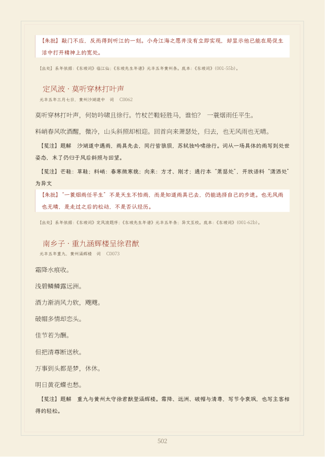
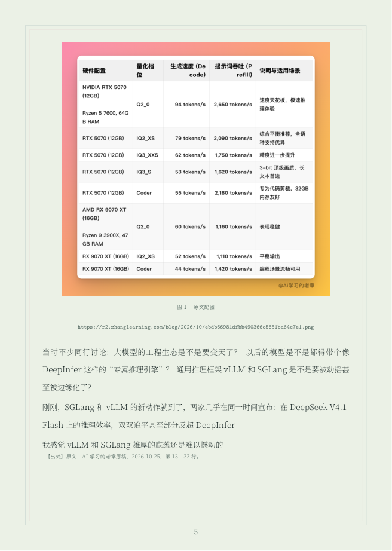

# 我花了 10 小时 35 分，用 AI 编了一套装裱精美的诗集：Skills 开源了，附 6 套模板

大家好，我是 AI 学习的老章。

这次我做了一件看起来很有雅兴、实际上非常工程化的事：**让 AI 帮我搜集苏轼的诗词和史料，按创作时间重新组织，再做成一套带封面、批注、目录、索引和校验报告的编年诗传。**

最后，它不再只是一个苏轼项目。

我把它抽象成了一个可以重复调用的 **Poetry Book Skill**，做了 6 套模板，并进一步支持 Markdown 技术文章。代码已经开源：

**https://github.com/tjxj/z-skills/tree/main/z-poetry-book**

这篇文章不准备讲“我输入一句话，AI 三分钟帮我出了一本书”。真实过程是：**10 小时 35 分 02 秒、超过 100M 的累计上下文处理、反复推翻的版式，以及一轮又一轮测试。**

## 一、先看最后做出来的东西

正式书名叫：

**《用诗词读懂苏轼——一蓑烟雨任平生》**

成品是 1448 页的简体横排 PDF，共收 3202 条作品：

- 诗 2824 条；
- 词 362 条；
- 赋、记、传、铭等其他作品 16 条；
- 82 篇名篇有专门题解、字词注和批语；
- 2651 条有古籍互见记录；
- 2394 条有系年或区间依据；
- 其余 808 条明确保留“未系年”，没有为了整齐而编一个年份。


这里我要特别强调：**3202 条是这次底本的实际收录规模，不是我拍脑袋宣布“世上苏轼作品已经一条不漏”。**

古籍有异本、重出、托名、辨疑和散佚材料。能下载、能匹配、能校核到什么程度，就老实统计到什么程度，这比在封面上写“绝对全集”更重要。

## 二、最初的需求，其实很不“软件工程”

我最开始提的要求非常直接：

- 广泛搜索正史材料；
- 尽可能完整收集苏轼诗词，能下载就下载；
- 按时间排序，用作品串起苏轼的一生；
- 做成古书风格，有批注，封面要有宋代审美；
- 最重要的是，完成后详细测试，不要出 bug。

这听起来像是一个“资料整理＋封面设计”的任务。

真正开始后才发现，它至少同时是五个项目：**史料项目、数据项目、编辑项目、排版项目和测试项目。**

AI 可以帮我加速，但不能替我把“全集”“系年”“原文”“批注”这些概念糊弄过去。

## 三、先把史料找齐，而不是让模型凭记忆写诗

这次共下载并登记了 11 个古籍与开放资料仓库，以及 18 个维基文库页面。

主要底本包括《东坡全集》《东坡诗集注》《施注苏诗》《苏诗补注》《东坡词》，并参考《宋史·苏轼传》、苏辙撰写的墓志铭、年谱和《续资治通鉴长编》等资料。

开放诗词语料用来建立检索基线，古籍文本用来互校。现代年谱和整理本主要用于核对事实与记录参考书目，没有批量复制现代注本文字。

每个资料仓库、页面、提交号、修订号和文件校验值都留在来源清单中。这样做有一个好处：书中的内容不是“模型好像记得”，而是可以回到具体文件和卷页继续查。

## 四、最难的不是收集，而是把作品放回时间里

诗词整理不是按标题排个序就结束。

同题异作不能只凭题名合并；组诗不能只保留第一首；词牌相同也不等于同一首词。原始文本、规范化文本、展示文本和编者批注必须分层保存。

编年更容易出错：

- 有些作品只能确定卷次或人生阶段；
- 有些题序是在追述往事，不能把往事年份当成写作年份；
- 年号改元、农历跨年、重复干支都要分别处理；
- 没有可靠证据的作品，应该放在“系年未详”，而不是硬塞进某一年。

最后的结构是：先有一段史料导引，再按时间放入作品。读者看到的不是孤立的诗词清单，而是眉山出蜀、凤翔初入仕途、密州、乌台诗案、黄州突围、惠州、儋州和北归的人生长卷。

## 五、10 小时 35 分，究竟花在了哪里

我按会话记录和文件时间戳复盘了首版任务。下面不是估算，而是按里程碑计算的实际时间：

| 环节 | 用时 |
|---|---:|
| 需求梳理、环境检查与资料调研 | 15 分 23 秒 |
| 项目骨架、古籍及开放语料下载 | 15 分 26 秒 |
| 诗词全集抽取、古籍匹配与编年 | 2 小时 07 分 16 秒 |
| 名篇批注与补充诗文 | 8 分 55 秒 |
| 宋代审美封面、竖版初稿与初版全书 | 2 小时 57 分 03 秒 |
| 测试修复、字体处理、简体横排重建 | 4 小时 46 分 55 秒 |
| 最终验收、预览与交付 | 4 分 04 秒 |
| **合计** | **10 小时 35 分 02 秒** |

下载、编译和部分写作存在并行，所以这不是严格串行的人工工时。但这个表很能说明问题：

**设计和排版很耗时，测试和修复更耗时。**

初版曾采用竖排古书风。做出半成品后，实际阅读体验并不理想，于是又明确改成简体横排。这个决定意味着目录、页码、正文、字体和全部预览都要重新检查，不是把页面转 90 度就完事。

宋代审美最后主要留在米白纸色、淡墨远山、江面、朱印和留白里；正文则回到更适合连续阅读的横排。

## 六、超过 100M 上下文，到底是怎么来的

首版正式交付时，日志里共有 317 条模型用量记录：

| 类型 | Token 数 |
|---|---:|
| 普通输入 `inputOther` | 3,628,228 |
| 输出 `output` | 274,751 |
| 缓存读取 `inputCacheRead` | 165,809,377 |
| 缓存创建 `inputCacheCreation` | 0 |
| **合计** | **169,712,356** |

普通输入加输出是 3,902,979 Token；把缓存读取也纳入，累计约 1.697 亿 Token，确实已经超过 100M。

但这个数字必须解释清楚：

**它不是一次性 100M 的上下文窗口，也不是 1.697 亿个互不重复的新字。**

长任务会反复携带书稿结构、工具返回、古籍索引、错误日志和前文结果。缓存读取反映了多轮协作中重复使用的上下文，不能与普通新输入按相同内容量或价格理解。后续六套模板和技术文章模式又继续产生了用量，本文保留首版交付时的统计口径，不把后续工作混进首版的 10 小时 35 分。

我对这个数字的态度不是“消耗越大越先进”，而是：**长任务必须留下可复核的产物，否则再多 Token 也只是昂贵的对话。**

## 七、隆重介绍这 6 套模板

完成苏轼书之后，我没有停在一张封面上，而是把纸色、墨色、装帧线和封面构图拆成了真正的主题系统。


### 1. 烟雨留白 `song-mist`

默认主题。米白、淡墨、远山、江面、小舟和朱印，最接近最初那本苏轼诗传。适合诗人编年、古文和需要大量留白的内容。

### 2. 青瓷天青 `celadon`

浅青灰纸色和青绿层山，更清透、温润。除了诗词，也很适合技术专题和课程讲义。后面的老章 AI 技术文章用的就是这一套。

### 3. 墨禅寂照 `ink-zen`

灰白纸色、极简墨山和圆相，批注从“朱批”变成“墨评”。克制、安静，适合哲学、散文和极简技术文档。

### 4. 朱砂印谱 `cinnabar-seal`

米纸和朱砂构成更强的印章秩序，参考宋人鉴藏印谱。适合做作品集、专题选本和强调编辑印记的内容。

### 5. 月夜赤壁 `moon-river`

蓝灰纸色、明月、江面水纹和夜航小舟。第一版月亮太淡，后来专门提高对比度并重新测试。适合游记、夜读和带叙事感的主题。

### 6. 竹影清风 `bamboo`

淡青绿纸色和疏竹构图，清雅但不遮挡文字。适合诗文、笔记和轻松的专栏合集。

这 6 套都实际生成过 PDF，不是文档里写了几个主题名字。每套样张为 39 页、21 条代表作品，逐套通过 17 项检查。完整青瓷版也重新生成了 1448 页、3202 条作品。

## 八、真正值钱的不是模板，而是校验机制

这本书首版做了 105 项检查；增加主题资源和产物防覆盖测试后，当前默认全书是 108 项检查。

除了常见的“能不能编译”，还检查：

- 3202 条作品的 ID 是否真的出现在对应 PDF 页面；
- 代表诗文是否存在；
- 字体是否嵌入，生僻字是否缺字；
- 是否误用 Last Resort 或 Unifont；
- 是否有排版溢出、文字越界和异常空白页；
- 目录四位页码是否正常；
- 是否保持横排；
- Ghostscript 能否解析全部页面。

过程中并不是没有 bug。生僻字回退命令的空格、目录页码宽度、样张与完整书输出互相覆盖，都被实际测试发现后修复了。

**“没有 bug”不是一句承诺，而是一组可重复执行的验证。**



## 九、从诗词到技术文章，它又往前走了一步

如果只能处理苏轼，那仍然只是一个项目，不是一个通用 Skill。

所以我又拿自己的 DeepInfer 技术文章做了一次实验，生成：

**《打平 DeepInfer——SGLang 与 vLLM 联袂反攻》**


这本小册采用青瓷天青和“老章”印章，最后为 15 页、5 个内容区段、7 张原图，通过 22 项检查。

它保留原稿的标题、粗体、列表、链接和图片；每个内容区段记录原稿行号，不再显示诗词模式里的“系年依据”。图片会检查数量和宽高比，链接会检查是否保留，PDF 里不能出现 `**`、`` 这类 Markdown 残留。

原稿副本与 iCloud 原文件的 SHA-256 完全一致，74 个非空正文行全部覆盖，7 张图片的哈希和尺寸也全部一致。安装 Skill 后，可以脱离原目录离线重建，结果仍然是 15 页。



另外还做了一份包含长代码、表格、引用和链接的技术夹具，生成 5 页 PDF，通过 20 项检查。这说明技术文章模式不是只给这一篇写死的 LaTeX。


文章里的性能数据和趋势判断仍然属于原文。排版不等于独立事实核验，这个边界也必须保留。

## 十、这个 Skill 到底开源了什么

开源仓库里包括：

- 六套 LaTeX 主题和共享样式；
- 结构化书稿构建器；
- Markdown 技术文章解析器；
- 图片下载、尺寸与 SHA-256 清单；
- 字体回退和 PDF 校验器；
- 李清照示例、老章技术专题、代码与表格夹具；
- 22 项单元测试、离线构建命令和这篇过程文章。

结构化书稿可以这样生成：

```bash
python3 scripts/render_book.py \
  --input "/absolute/path/book.json" \
  --theme song-mist \
  --output "/absolute/path/new-output"
```

普通 Markdown 技术文章可以这样生成：

```bash
python3 scripts/render_article.py \
  --input "/absolute/path/article.md" \
  --theme celadon \
  --title "文章主标题" \
  --subtitle "文章副标题" \
  --author "作者或栏目名" \
  --seal "印章文字" \
  --output "/absolute/path/new-output"
```

安装、依赖、测试方式和目前不支持的 Markdown 扩展，都写进了 README。

代码采用 MIT 许可；字体保留各自许可；范文和原文配图只作演示，不随代码重新授权。

## 最后：我真正开源的不是一本苏轼书

回看整个过程，最有价值的不是“AI 帮我写了一本书”，而是把一次性的长任务，拆成了可以反复使用的生产能力：

**资料有来源，内容有结构，编辑有层次，视觉有模板，生成有记录，结果有验证。**

以后换一位诗人，可以替换史料、年谱和作品库；换一篇技术文章，可以直接从 Markdown 和图片开始；换一种审美，只需要选择另一套主题。

这才是我想开源的 Poetry Book。

**仓库地址：https://github.com/tjxj/z-skills/tree/main/z-poetry-book**
