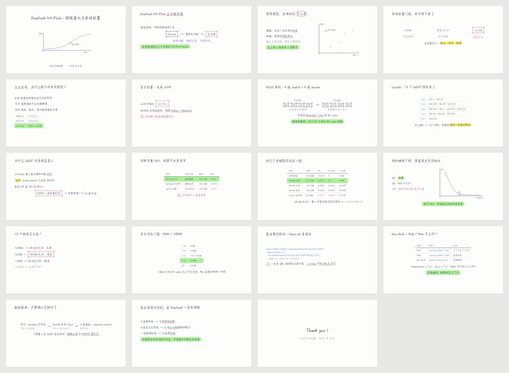

# z-wanghong-handwritten-ppt

把文章、讲稿或技术主题做成王虹学术报告风格的 16:9 手写 HTML 幻灯片：近白纸面、小号深蓝手写字、短红线、四角出头的细红框、绿色荧光结论带、红色警示三角、词语思维导图、带说明的截图，以及大量留白。



## 产出

一份 `slides.html` 源稿，构建出：

- `index.html`：整页版。翻页、总览（O）、讲稿（N）、演讲者视图（S，双屏，含下一页和计时）、自动播放（P）、黑白屏（B / W）、全屏（F）。
- `index-timeline.html`：逐步书写版。每按一次写出下一步：文字逐行写出，框线和圈按笔画画出，荧光从左向右扫过，箭头标注最后出现。
- `png/01.png …`、`contact-sheet.png`，可选 `deck.pdf`。

两个 HTML 都是单文件：手写字体（按本稿用字裁剪）、样式、脚本、图片全部内嵌，断网、换电脑、微信发送都能直接打开。

## 快速开始

```bash
cp templates/slides.html ~/talk/slides.html        # 改内容
python3 scripts/build.py ~/talk/slides.html         # → index.html + index-timeline.html
python3 scripts/check_deck.py ~/talk/index.html     # 浏览器逐页排版检查
python3 scripts/render.py ~/talk/index.html --pdf   # → png/ + contact-sheet.png + deck.pdf
```

Windows 把 `python3` 换成 `py`，路径用反斜杠即可。

## 环境

| 需要 | 说明 |
|---|---|
| Python 3.9+ | 只用标准库即可构建 |
| Chrome 或 Edge | 检查与导出用；自动查找，或用 `--chrome` / 环境变量 `WH_CHROME` 指定 |
| 可选 `pip install fonttools brotli pillow` | 字体按用字裁剪（单文件从几 MB 降到几百 KB）、图片压缩为 WebP |

字体：macOS 装了“翩翩体-简”（字体册里下载）时默认使用它；其他情况自动使用随附的开源小赖字体（SIL OFL 1.1）。`--font xiaolai` 可强制使用小赖字体，保证各平台字形一致。

## 目录

- `SKILL.md`：执行流程
- `templates/slides.html`：9 种页型起步模板
- `assets/template.css`、`assets/runtime.js`：样式与运行时
- `assets/fonts/`：小赖字体 GB2312 子集与许可证
- `scripts/`：`build.py` 构建、`check_deck.py` 检查、`render.py` 导出
- `references/style-guide.md`：根据王虹报告实拍拆解的视觉规则
- `references/components.md`：组件手册
- `references/prompts.md`：用图片模型生成单页的提示词
- `examples/deepseek-v4-flash/`：19 页完整示例（源稿 + 两个成品）
- `tests/`：`python3 -m unittest discover -s tests`

## 致谢

小赖字体（Xiaolai）由 lxgw 维护，基于 SIL Open Font License 1.1 发布，许可证见 `assets/fonts/OFL.txt`。
