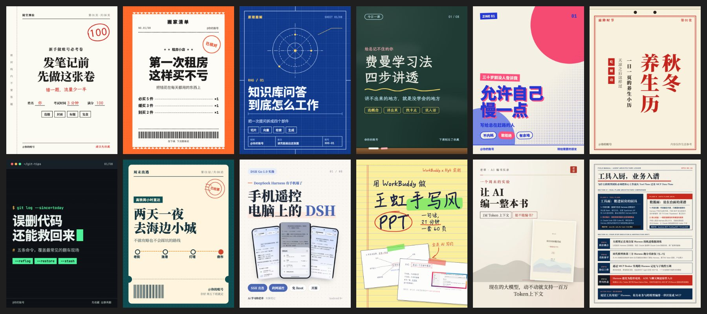
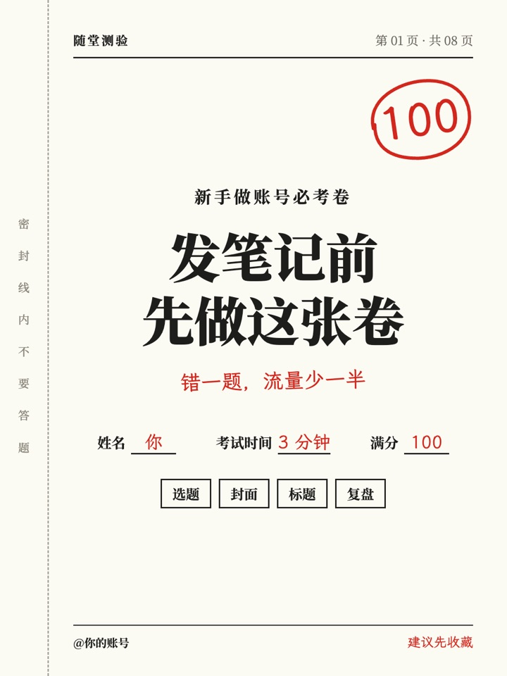
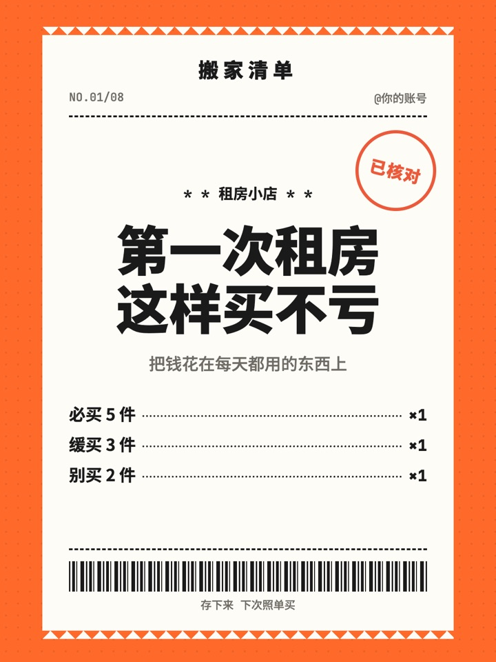
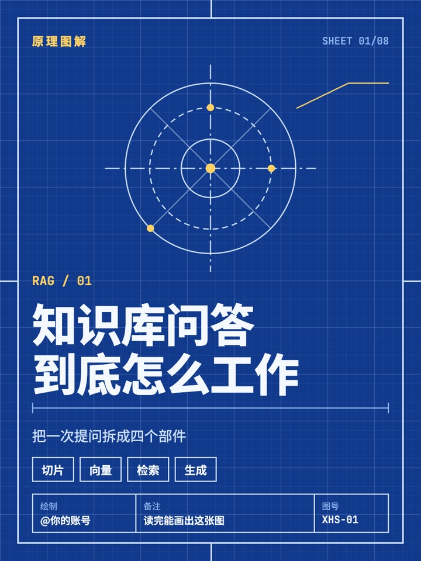
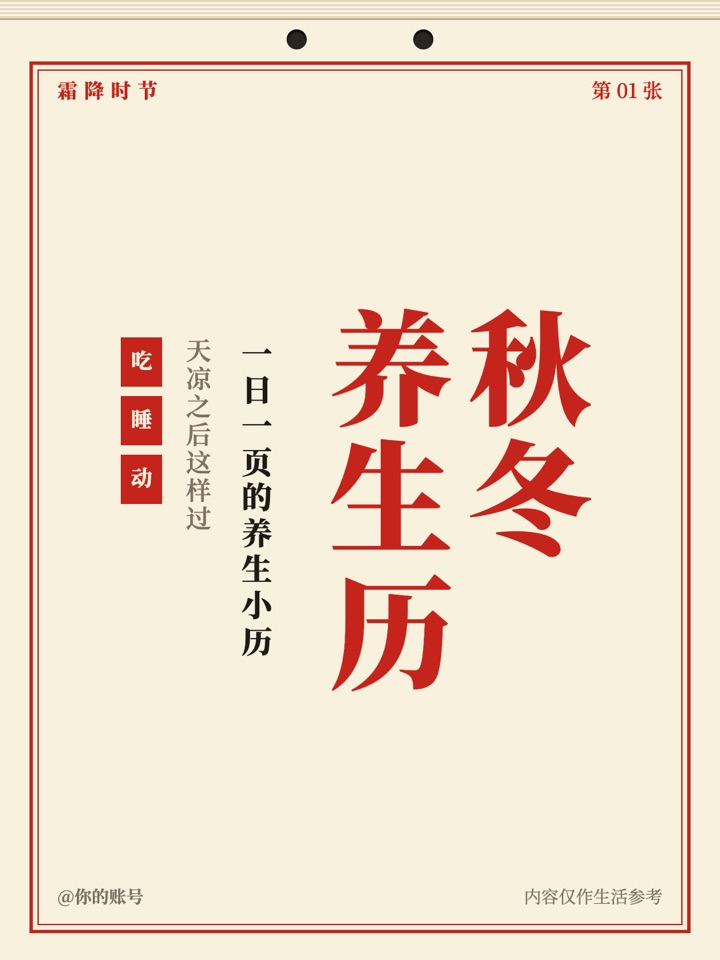
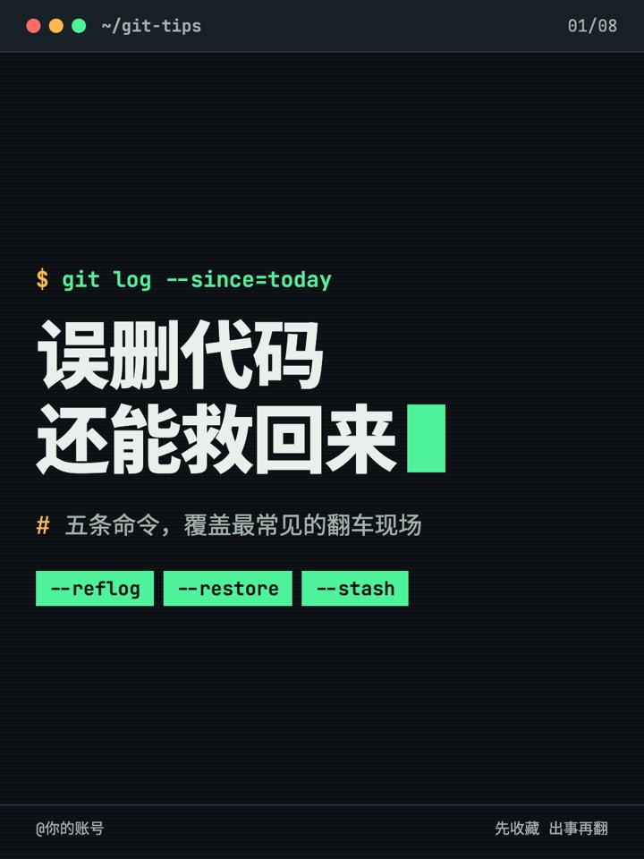
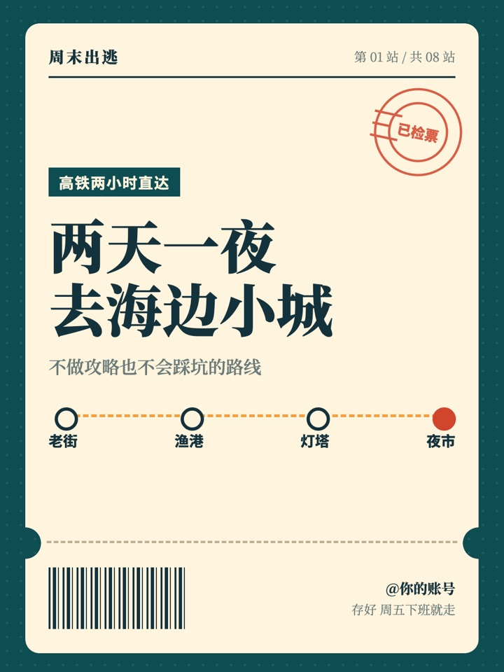
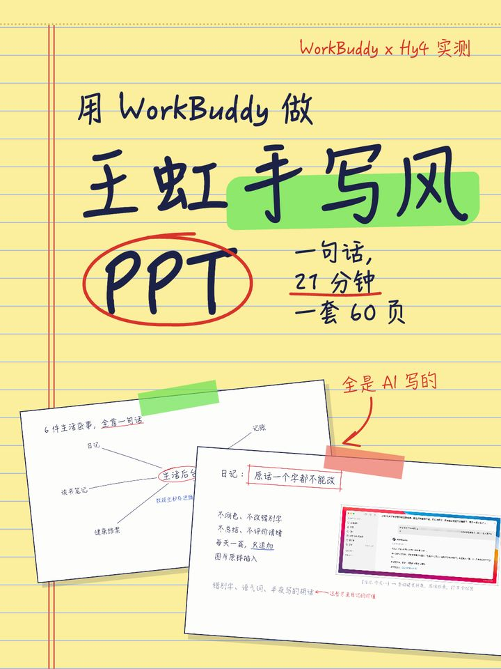
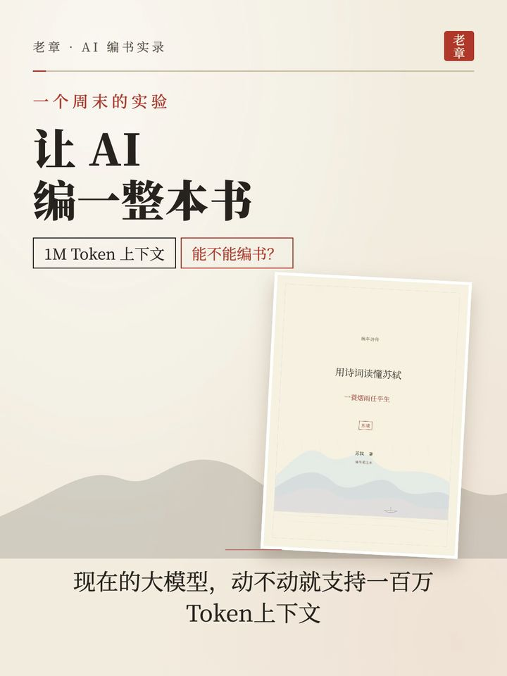
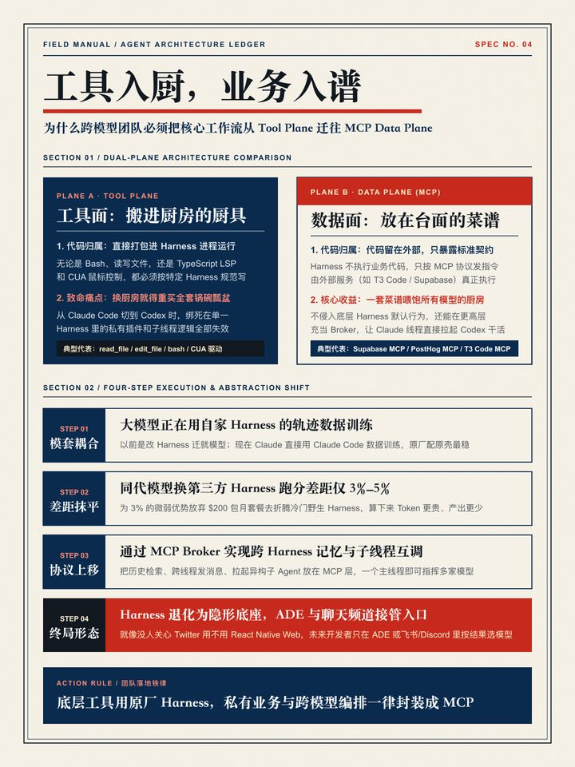

# z-xiaohongshu-cards

一个持续生长的小红书 3:4 风格库。把文章交给 Agent，选一种风格，得到一组 1080×1440 PNG；做出新风格后，再把它沉淀回来。



## 安装

```bash
npx skills add tjxj/z-skills --skill z-xiaohongshu-cards
npm i playwright @fontsource-variable/noto-serif-sc @fontsource-variable/noto-sans-sc @fontsource-variable/jetbrains-mono lxgw-wenkai-webfont
```

渲染优先使用系统 Chrome，没有时使用 Playwright 自带的 Chromium（`npx playwright install chromium`）。

## 使用

对 Agent 说：

```text
把这篇文章做成小红书 3:4 卡片，用红笔试卷风格
```

手动使用：写一份 `content.json`（格式见 [references/content-schema.md](references/content-schema.md)），再生成和渲染：

```bash
node scripts/build.cjs content.json --style exam-paper --out cards.html
node scripts/render.cjs cards.html --out ./output --sheet ./output/sheet.jpg
```

同一份内容换个 `--style` 就能换风格。

## 为什么稳定

- **内容和版式分开**：Agent 只写 JSON，不碰 HTML 和 CSS，不同模型做出来的版式一致。
- **8 种固定页面**：封面、要点、步骤、对比、金句、数字、配图、结尾，每种风格都实现全部页面。
- **字数上限**：超限时列出具体位置，改完才能生成。
- **自动缩字**：放不下时在字号下限内缩字，缩到下限还放不下就报错。
- **字体随包安装**：字体来自 npm 开源包，不依赖系统字体。
- **压测**：`tests/stress.json` 把每个字段写到上限，每种风格都要通过。

## 风格

| 样图 | 风格 | 气质 | 适合 |
|---|---|---|---|
|  | **红笔试卷**<br>`exam-paper` | 铅印考卷加老师红笔批改，一眼就想拿笔做题 | 避坑清单、知识自测、新手必看 |
|  | **热敏小票**<br>`receipt-strip` | 橙色台面上的收银小票，一条条明细像在结账 | 购物清单、预算账单、好物测评 |
|  | **蓝晒图纸**<br>`blueprint` | 普鲁士蓝工程图，白线、尺寸线和标题栏 | 技术原理、系统架构、产品拆解 |
|  | **粉笔黑板**<br>`blackboard` | 墨绿黑板上的粉笔板书，有擦痕和粉笔槽 | 学习方法、知识点、读书笔记 |
|  | **双色孔版**<br>`riso-zine` | 荧光粉和群青两色叠印，错版阴影 | 个人成长、观点表达、活动海报 |
|  | **老黄历**<br>`almanac` | 撕页挂历，大字直排，红绿双色油墨 | 节气养生、生活习惯、日常宜忌 |
|  | **深夜终端**<br>`night-terminal` | 黑底绿字的命令行窗口，提示符串起全页 | 开发教程、命令速查、AI 工具 |
|  | **票根旅程**<br>`ticket-stub` | 硬纸车票、打孔缺口和撕票线，每页都是一站 | 旅行攻略、探店路线、周末计划 |
|  | **暖纸蓝橙**<br>`warm-paper` | 暖米色点阵纸上的产品手册，亲和、清楚 | 产品上手、App 教程、功能清单、对比选型 |
|  | **黄便签手写**<br>`legal-pad` | 黄色法律便签上贴图批注，像人亲手整理的笔记 | 教程、方法论、作品展示、学术与工具测评 |
|  | **宣纸朱印**<br>`rice-seal` | 装裱宣纸、远山、朱红印章，人文书卷气 | 诗词、历史、读书、人文项目 |
|  | **现场手册**<br>`field-manual` | 象牙纸、海军蓝、信号红的工业手册台账 | 架构解释、SOP、决策清单、方法论 |

前 8 种是 JSON 风格：目录里有 `style.css`、`pages.html`、`sample.json`、`STYLE.md`、`preview.jpg` 和 `samples/`，样图文案都是虚构示例。后 4 种是模板风格：复制 `template.html` 后手改，`samples/` 是原作样图，模板示例用斜纹占位块代替原始截图。

## 复现

```bash
node scripts/check_all.cjs
```

命令会重新渲染全部风格，检查 1080×1440 尺寸、文字越界、最小字号、必备文件和本机路径，JSON 风格还要通过极限内容压测。

## 字体

| 字体 | 用途 | 授权 |
|---|---|---|
| Noto Serif SC（与思源宋体同源） | 宋体标题和正文 | SIL OFL |
| Noto Sans SC | 黑体标题和正文 | SIL OFL |
| JetBrains Mono | 数字和代码 | SIL OFL |
| 霞鹜文楷 | 手写批注和板书 | SIL OFL |

系统装了 `SourceHanSerifSC-VF.ttf` 时优先使用，也可用 `XHS_SERIF_FONT=/路径/字体.ttf` 指定。模板风格 `legal-pad` 依赖 macOS 自带的翩翩体，其他系统换小赖。

## 新增风格

按 [references/add-style.md](references/add-style.md) 操作。
