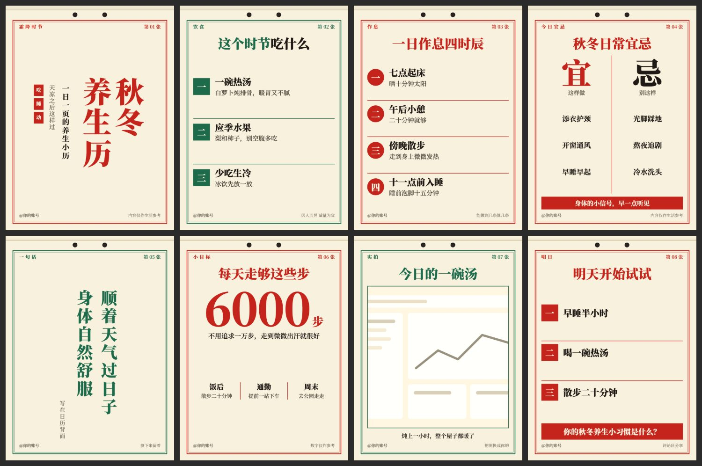

# 老黄历 `almanac`

撕页挂历，大字直排，红绿双色油墨。



## 什么时候用

节气养生、生活习惯、日常宜忌、传统文化。

## 色板

纸 `#F8F1DE` · 墨 `#1F1A15` · 朱红 `#C4241B` · 墨绿 `#1E6B4C`

## 字体

思源宋体 Heavy，封面和金句直排。

## 招牌元素

顶部撕页和挂孔、双线边框、中文序号、宜忌大字、日历式大数字、红绿交替。

## 注意

封面和 `quote` 是直排：标题用 `\n` 分列，每列不超过 9 字，尽量少用西文。

## 复现

```bash
node scripts/build.cjs styles/almanac/sample.json --out styles/almanac/cards.html
node scripts/render.cjs styles/almanac/cards.html --out ./output
```

风格由 `style.css` 和 `pages.html` 定义，`sample.json` 是示范内容。

## 样图

`samples/` 是 `sample.json` 的渲染结果，文案为虚构示例。
