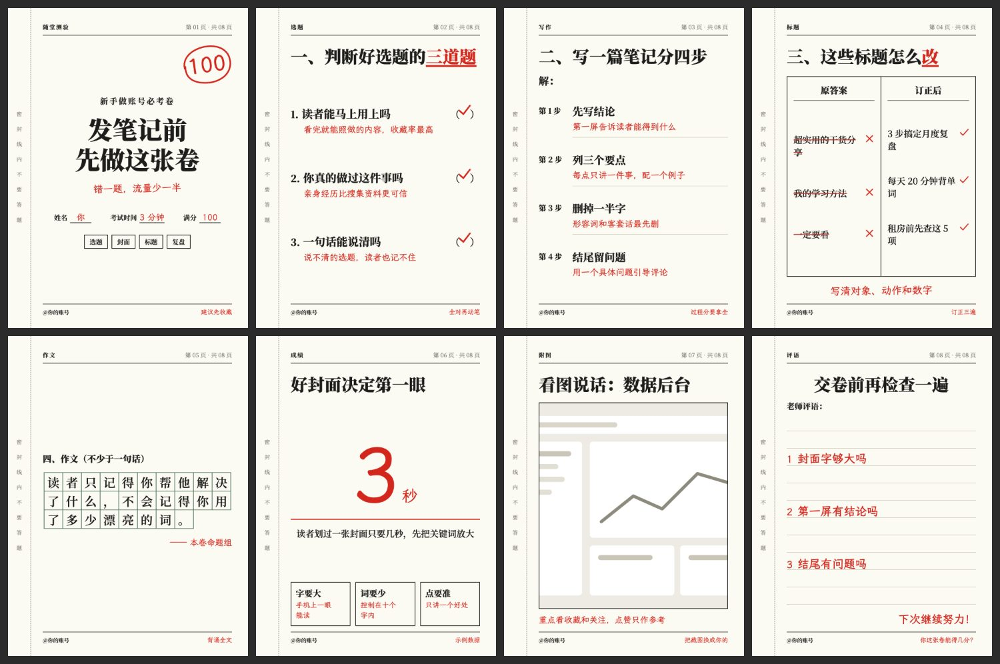

# 红笔试卷 `exam-paper`

铅印考卷加老师红笔批改，一眼就想拿笔做题。



## 什么时候用

避坑清单、知识自测、新手必看、常见错误。

## 色板

纸 `#FBFAF3` · 墨 `#1D1D1B` · 红笔 `#D3271D` · 稿纸绿 `#5D7F68`

## 字体

思源宋体负责铅印题目，霞鹜文楷负责红笔批注。

## 招牌元素

左侧密封线、满分红圈、括号里的红勾、错题划掉、作文方格纸、老师评语。

## 注意

作文方格每行 10 字，`quote` 控制在 48 字内；红色只给批改内容用。

## 复现

```bash
node scripts/build.cjs styles/exam-paper/sample.json --out styles/exam-paper/cards.html
node scripts/render.cjs styles/exam-paper/cards.html --out ./output
```

风格由 `style.css` 和 `pages.html` 定义，`sample.json` 是示范内容。

## 样图

`samples/` 是 `sample.json` 的渲染结果，文案为虚构示例。
