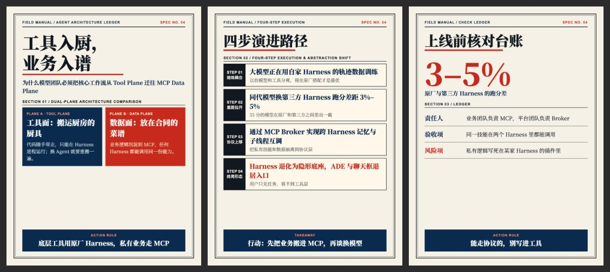

# 现场手册 `field-manual`

象牙纸、海军蓝、信号红的工业手册台账。



## 什么时候用

架构解释、SOP、决策清单、方法论。

## 色板

象牙 `#F6F1E7` · 黑 `#111820` · 海军蓝 `#0A2B4E` · 信号红 `#C72A1D` · 灰 `#555A60` · 珊瑚 `#FF8B77`

## 字体

思源宋体 VF 配 Arial 小标签。

## 招牌元素

双线外框、SPEC 编号、双色对比面板、STEP 台账行、底部结论带。

## 注意

每页都要落到一句行动结论。

## 复现

```bash
cp styles/field-manual/template.html ./cards.html
node scripts/render.cjs ./cards.html --out ./output
```

`template.html` 是这个风格的唯一来源，改文字和图片就能出新内容。`.ph` 占位块换成 ``。

## 样图

来源：Harness 与 MCP 等现场手册配图。`samples/` 存的是原作，模板示例用占位图代替原始截图。
