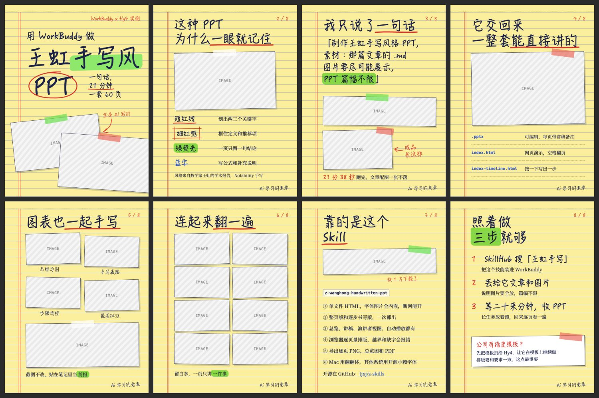

# 黄便签手写 `legal-pad`

黄色法律便签上贴图批注，像人亲手整理的笔记。



## 什么时候用

教程、方法论、作品展示、学术与工具测评。

## 色板

便签 `#FBEE9C` · 横线 `#A9BEDD` · 红边 `#E0574B` · 墨 `#1C2147` · 红 `#D8342B` · 蓝 `#2F55C8` · 荧光绿 `rgba(112,226,84,.82)`

## 字体

标题 HanziPen SC（翩翩体），Windows/Linux 换小赖；正文思源宋体 VF。

## 招牌元素

`.u` 手绘红下划线、`.bx` 交叉角红框、`.ci` 开口椭圆、胶带 `.tape`、歪贴的 `.slide`、红色手写批注。

## 注意

手绘标记由页面脚本按字体位置绘制，改完文字重新渲染即可。

## 复现

```bash
cp styles/legal-pad/template.html ./cards.html
node scripts/render.cjs ./cards.html --out ./output
```

`template.html` 是这个风格的唯一来源，改文字和图片就能出新内容。`.ph` 占位块换成 ``。

## 样图

来源：《用 WorkBuddy 做王虹手写风 PPT》小红书图文（8 页）。`samples/` 存的是原作，模板示例用占位图代替原始截图。
