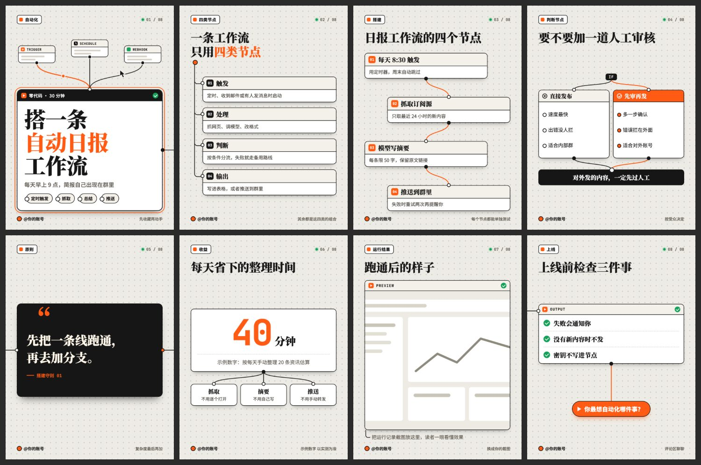

# 节点画布 `node-canvas`

点阵画布上的一组节点，端口和连线把内容串成一条工作流。



## 什么时候用

工作流、自动化、AI Agent 教程、工具搭建、流程拆解。

## 色板

画布 `#EDEBE5` · 点阵 `#C6C0B3` · 墨 `#161616` · 节点白 `#FFFFFF` · 标题栏 `#F4F1EA` · 信号橙 `#FF5B14` · 运行绿 `#16A05A`

## 字体

思源宋体 Heavy 做标题和节点名，Noto Sans 做正文，JetBrains Mono 做页码和节点标签。

## 招牌元素

点阵画布、带标题栏的节点、进出端口、贝塞尔连线、IF 分叉与汇合、选中节点的橙色描边、运行按钮式结尾。

## 注意

橙色只留给高亮词、主连线和行动按钮，别大面积铺色；连线按页面类型画好，文字长短变化也不会断线；封面上方的三个上游节点是固定装饰，不随内容变化。

## 复现

```bash
node scripts/build.cjs styles/node-canvas/sample.json --out styles/node-canvas/cards.html
node scripts/render.cjs styles/node-canvas/cards.html --out ./output
```

风格由 `style.css` 和 `pages.html` 定义，`sample.json` 是示范内容。

## 样图

`samples/` 是 `sample.json` 的渲染结果，文案为虚构示例。
