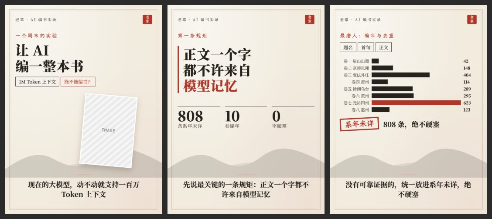

# 宣纸朱印 `rice-seal`

装裱宣纸、远山、朱红印章，人文书卷气。



## 什么时候用

诗词、历史、读书、人文项目。

## 色板

纸 `#F2ECDF` · 墨 `#26231F` · 灰 `#5A5348` · 朱 `#B0362A` · 青 `#5E8C86` · 线 `#CDBFA5`

## 字体

思源宋体 VF 配霞鹜文楷。

## 招牌元素

双线装裱框、远山剪影、朱印、盖章标签、卷目条形图。

## 注意

朱红只用于印章和最重要的一处。

## 复现

```bash
cp styles/rice-seal/template.html ./cards.html
node scripts/render.cjs ./cards.html --out ./output
```

`template.html` 是这个风格的唯一来源，改文字和图片就能出新内容。`.ph` 占位块换成 ``。

## 样图

来源：苏轼诗集 PoetryBook 视频。`samples/` 存的是原作，模板示例用占位图代替原始截图。
