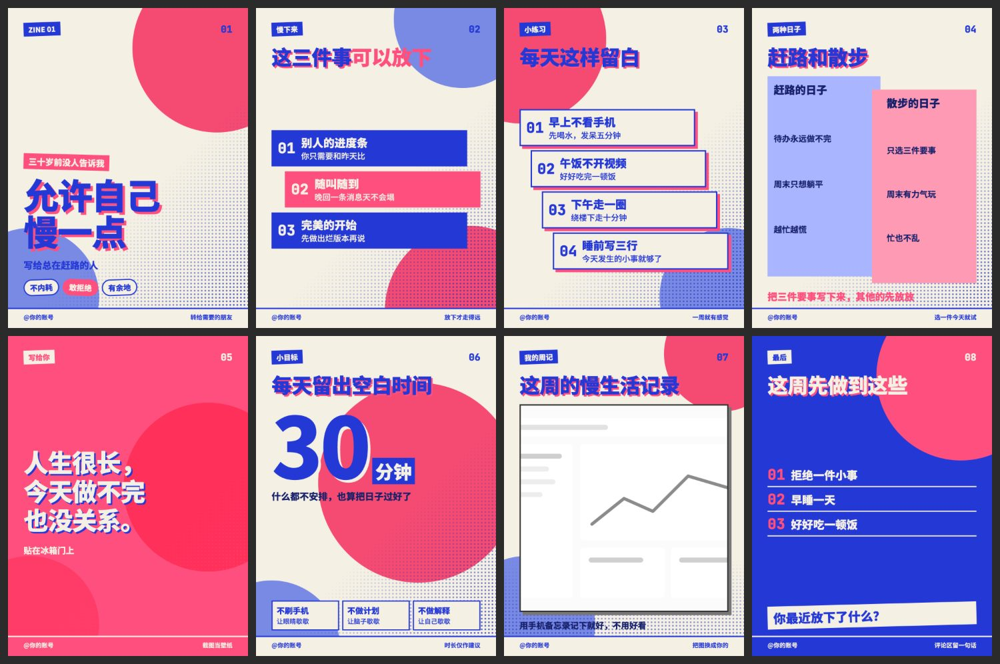

# 双色孔版 `riso-zine`

荧光粉和群青两色叠印，错版阴影，独立小志气质。



## 什么时候用

个人成长、观点表达、生活态度、活动海报。

## 色板

纸 `#F5F0E4` · 专色粉 `#FF4F7E` · 专色蓝 `#2438D6` · 叠印蓝 `#17206B`

## 字体

思源黑体 Heavy，标题用错版阴影。

## 招牌元素

大圆叠印、网点渐变、台阶卡片、错位对比块、整版粉色金句页、整版蓝色结尾页。

## 注意

全套只用两块专色，别加第三种颜色；图片自动转成黑白。

## 复现

```bash
node scripts/build.cjs styles/riso-zine/sample.json --out styles/riso-zine/cards.html
node scripts/render.cjs styles/riso-zine/cards.html --out ./output
```

风格由 `style.css` 和 `pages.html` 定义，`sample.json` 是示范内容。

## 样图

`samples/` 是 `sample.json` 的渲染结果，文案为虚构示例。
