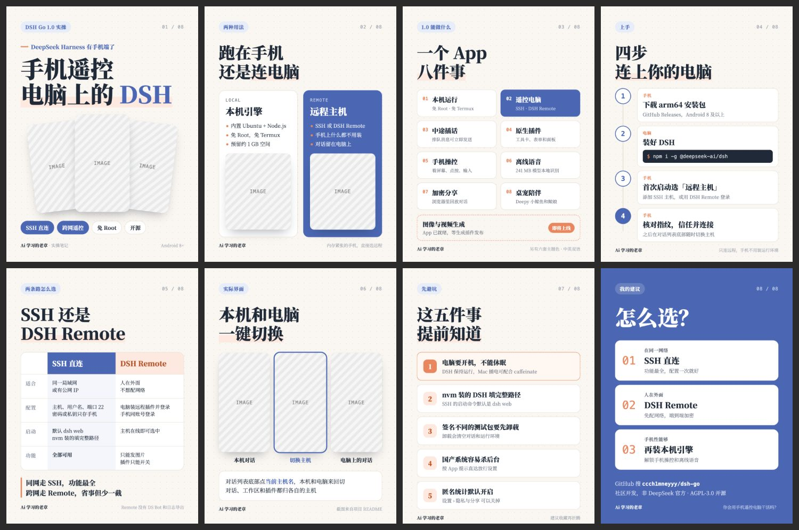

# 暖纸蓝橙 `warm-paper`

暖米色点阵纸上的产品手册，亲和、清楚。



## 什么时候用

产品上手、App 教程、功能清单、对比选型。

## 色板

纸 `#FAF7F2` · 点阵 `#E4DCCD` · 墨 `#1F2937` · 蓝 `#4B67B4` · 橙 `#E8875F`

## 字体

思源宋体 VF，页码用等宽字体。

## 招牌元素

蓝色胶囊标签、荧光笔式橙色底线、白色圆角卡片、扇形手机截图、最后一页整版蓝。

## 注意

手机截图优先用 9:16 竖图；每页只放一个高亮块。

## 复现

```bash
cp styles/warm-paper/template.html ./cards.html
node scripts/render.cjs ./cards.html --out ./output
```

`template.html` 是这个风格的唯一来源，改文字和图片就能出新内容。`.ph` 占位块换成 ``。

## 样图

来源：《DSH Go》小红书图文（8 页）。`samples/` 存的是原作，模板示例用占位图代替原始截图。
